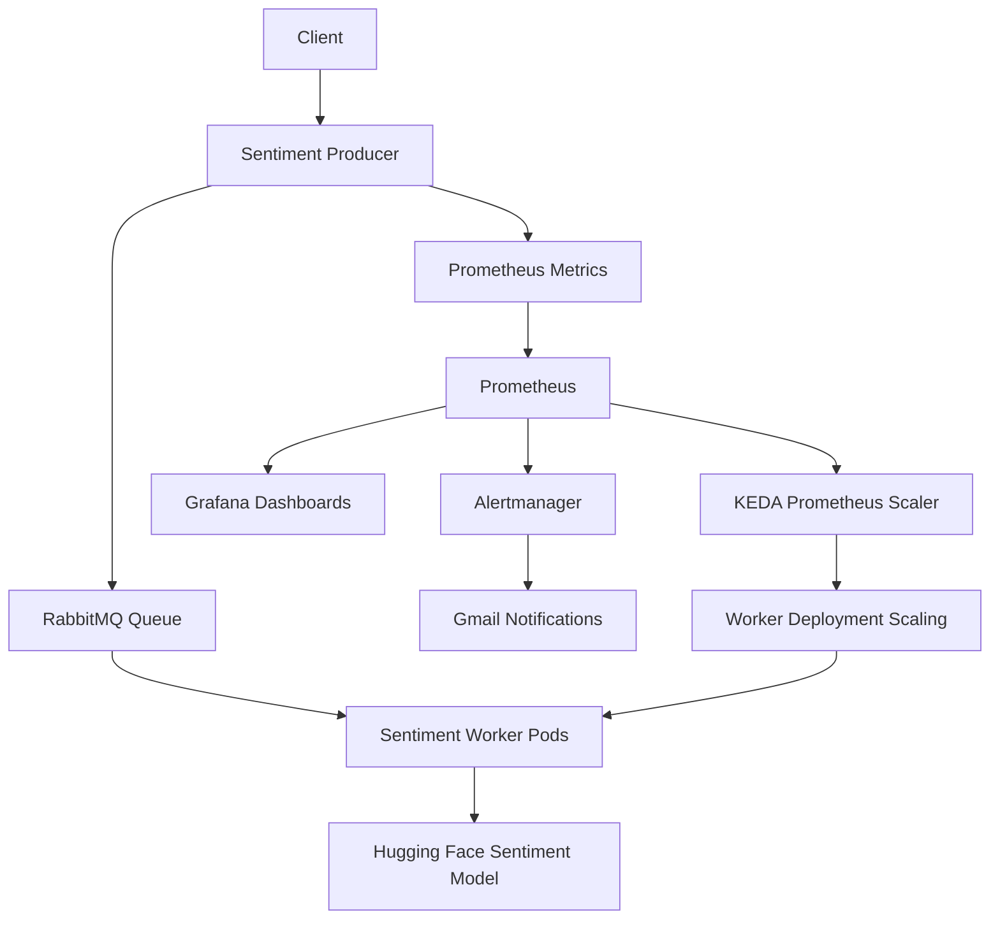

# 🚀 Sentiment Platform — Event-Driven MLOps on Kubernetes

**A cloud-native sentiment analysis platform featuring asynchronous message processing, event-driven autoscaling, Prometheus monitoring, and alerting.**

[](https://kubernetes.io/)
[](https://www.docker.com/)
[](https://keda.sh/)
[](https://prometheus.io/)
[](https://grafana.com/)

## 📌 Overview

**Sentiment Platform** is a Kubernetes-based application that processes text sentiment analysis requests through an asynchronous, event-driven architecture.

The platform uses a producer to publish incoming requests to RabbitMQ, while sentiment worker pods consume messages and perform sentiment analysis using a pretrained Hugging Face transformer model.

KEDA connects application metrics exposed to Prometheus with Kubernetes autoscaling, allowing the sentiment worker deployment to scale according to workload demand.

The project demonstrates how to combine containerization, message queues, Kubernetes orchestration, event-driven scaling, monitoring, and alerting in a practical cloud-native environment.

## 🏗️ Architecture



### 🔄 Request Processing Flow

1. **Request Ingestion:** The producer receives incoming sentiment analysis requests.
2. **Message Queuing:** Requests are published to RabbitMQ for asynchronous processing.
3. **Sentiment Analysis:** Worker pods consume queued messages and analyze text using a pretrained transformer model.
4. **Metrics Collection:** Prometheus scrapes application metrics to observe incoming request rates.
5. **Event-Driven Autoscaling:** KEDA evaluates Prometheus metrics and adjusts the worker deployment's replica count according to the configured scaling rules.
6. **Observability and Alerting:** Grafana provides monitoring dashboards, while Prometheus alert rules and Alertmanager handle alert notifications.

## 🛠️ Technology Stack

| Category | Technologies |
|---|---|
| Containerization | Docker |
| Orchestration | Kubernetes |
| Message Broker | RabbitMQ |
| Sentiment Analysis | Python, Hugging Face Transformers, PyTorch |
| Autoscaling | KEDA, Prometheus |
| Monitoring | Prometheus, Grafana |
| Alerting | PrometheusRule, Alertmanager, Gmail integration |
| Infrastructure | AWS EC2, kubeadm |
| Application Metrics | Prometheus-compatible metrics |

## ⚡ Event-Driven Autoscaling with KEDA

Traditional CPU-based autoscaling does not always reflect the actual demand of an asynchronous message-processing application.

This project uses KEDA with Prometheus metrics to scale the sentiment workers according to the configured incoming-request rate.

### Scaling Configuration

| Parameter | Configuration |
|---|---|
| Scaler type | Prometheus |
| Metric query | `sum(rate(sentiment_requests_enqueued_total[1m]))` |
| Minimum replicas | `0` |
| Maximum replicas | `5` |
| Polling interval | `15 seconds` |
| Cooldown period | `60 seconds` |
| Target workload | `sentiment-worker` |

*These values describe the intended project configuration and should match the deployed KEDA `ScaledObject`.*

### How It Works

1. Prometheus collects the producer's `sentiment_requests_enqueued_total` counter.
2. The PromQL query calculates the total rate of newly enqueued requests over a one-minute window.
3. KEDA queries Prometheus at the configured polling interval.
4. KEDA uses the resulting metric to determine the desired number of worker replicas.
5. When demand increases, more workers can process messages concurrently. When demand falls, the worker deployment can scale down, potentially to zero.

**Important:** Scaling workers increases processing capacity, but it does not automatically reduce queue depth unless the workers successfully consume and process messages faster than new messages arrive.

## 📊 Monitoring with Prometheus and Grafana

Prometheus is used to collect and query application metrics, while Grafana provides dashboards for visualizing platform behavior.

### Example PromQL Queries

**Incoming request rate**

```promql
sum(rate(sentiment_requests_enqueued_total[1m]))
```

**Incoming request rate over time**

```promql
sum(rate(sentiment_requests_enqueued_total[5m]))
```

These queries help observe incoming workload and evaluate whether the autoscaling configuration responds appropriately to changes in traffic.

## 🚨 Alerting with Alertmanager

The project includes a `PrometheusRule` for detecting elevated incoming request rates.

### Example Alert Rule

```yaml
- alert: SentimentQueueRateHigh
  expr: sum(rate(sentiment_requests_enqueued_total[1m])) > 0.311
  for: 1m
  labels:
    severity: warning
  annotations:
    summary: "Sentiment message rate exceeded threshold"
    description: "The enqueue rate has exceeded 0.311 messages per second for 1 minute."
```

When the expression remains above the configured threshold for one minute, Prometheus can transition the alert to the firing state. Alertmanager then handles routing and delivery according to its notification configuration.

The intended notification channel is Gmail.

**Note:** The alert threshold is independent of the KEDA scaling threshold. They serve different purposes: one detects elevated traffic, while the other controls scaling behavior.

## ☸️ Kubernetes Deployment

The platform runs on a Kubernetes cluster provisioned using `kubeadm` on AWS EC2 instances.

The cluster orchestrates the producer, RabbitMQ, sentiment workers, and monitoring components.

### Useful Commands

**Inspect application pods**

```bash
kubectl get pods -A
```

**Inspect worker deployment and replicas**

```bash
kubectl get deployment sentiment-worker -n sentiment-app
```

**Inspect KEDA scaling resources**

```bash
kubectl get scaledobject -A
kubectl get hpa -A
```

**Inspect application metrics**

```bash
curl -s http://localhost:8000/metrics
```

The last command assumes the producer's metrics endpoint is accessible locally on port `8000`, for example through an existing port-forward.

**Inspect monitoring resources**

```bash
kubectl get prometheusrule -n monitoring
kubectl get alertmanager -n monitoring
```

## 🧪 Testing and Validation

The platform can be validated by generating requests and observing how the system responds.

- **Producer:** Verify that requests are accepted and published successfully.
- **RabbitMQ:** Confirm that messages enter the queue and are consumed by workers.
- **Workers:** Verify successful sentiment processing and inspect pod logs.
- **KEDA:** Observe replica changes as the configured metric changes.
- **Prometheus:** Query the incoming request rate and inspect alert states.
- **Grafana:** Visualize metrics and workload behavior.
- **Alertmanager:** Verify that firing alerts are routed to the configured Gmail receiver.

A successful test should demonstrate that incoming requests are processed, worker capacity responds to workload changes, and monitoring components expose the relevant application behavior.

## 🔐 Security Considerations

- Store credentials and application passwords in Kubernetes Secrets or an appropriate external secret-management system.
- Avoid committing `.env` files, tokens, passwords, or unencrypted secret manifests to Git.
- Apply least-privilege permissions to Kubernetes service accounts and AWS IAM roles.
- Restrict access to monitoring interfaces and application endpoints.
- Use TLS and appropriate authentication when exposing services beyond the cluster.

## 🎯 Key Engineering Concepts Demonstrated

- Containerized application deployment with Docker.
- Kubernetes workload orchestration.
- Asynchronous processing using RabbitMQ.
- Integration of Prometheus metrics with KEDA.
- Event-driven scaling of Kubernetes deployments.
- Application observability using Prometheus and Grafana.
- Alert rule configuration and notification routing.
- Deployment and troubleshooting on an AWS-hosted Kubernetes cluster.

## 🚀 Future Improvements

- Add Helm charts for repeatable application deployment.
- Implement CI/CD using GitHub Actions.
- Add automated application and integration tests.
- Introduce centralized logging.
- Add queue-depth and processing-latency metrics.
- Implement resource requests, limits, and workload-specific scaling policies.
- Add infrastructure provisioning and configuration management with Terraform and Ansible.

## 👨‍💻 Author

**Alaa Ibrahim**

GitHub: [@Alaaibrahim2](https://github.com/Alaaibrahim2)

---

*Built as a hands-on cloud-native project exploring the intersection of Kubernetes, event-driven architecture, observability, and MLOps.*
